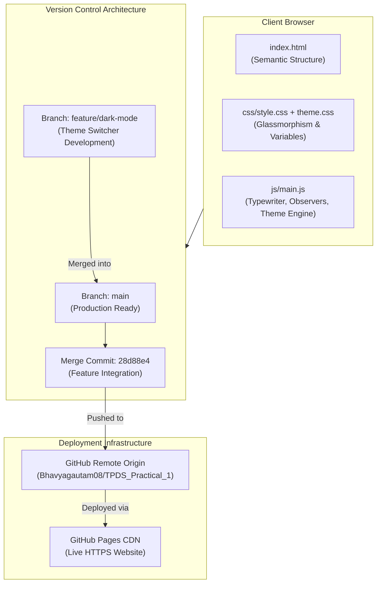

# Practical 1: Portfolio Website & Version Control System

**Course:** TPDS — Module 4  
**Topic:** Version Control with Git & GitHub | Responsive Web Engineering  
**Candidate Name:** Bhavya | B.Tech Computer Science  
**Repository:** [https://github.com/Bhavyagautam08/TPDS_Practical_1](https://github.com/Bhavyagautam08/TPDS_Practical_1)  
**Live Deployed Application:** [https://bhavyagautam08.github.io/TPDS_Practical_1/](https://bhavyagautam08.github.io/TPDS_Practical_1/)  

---

## 🎯 Practical Objective & Overview

This project implements a high-performance, responsive **Developer Portfolio Web Application** and demonstrates rigorous **Version Control Best Practices using Git and GitHub**. 

The submission is structured to showcase:
1. **Frontend Architecture:** Semantic HTML5, responsive layout via Bootstrap 5 and custom CSS3 with glassmorphic styling, and asynchronous DOM manipulation via vanilla ES6+ JavaScript.
2. **Git Version Control Methodology:** Feature branch isolation (`feature/dark-mode`), semantic commit conventions, local-to-remote synchronization, and branch integration into `main`.
3. **Cloud Static Deployment:** Continuous delivery and live hosting via **GitHub Pages**.

---

## 🔗 Project Access Links

| Resource | Target Link | Description |
|---|---|---|
| **Source Code Repository** | [github.com/Bhavyagautam08/TPDS_Practical_1](https://github.com/Bhavyagautam08/TPDS_Practical_1) | Complete Git repository with commit history & feature branches |
| **Live Web Deployment** | [bhavyagautam08.github.io/TPDS_Practical_1](https://bhavyagautam08.github.io/TPDS_Practical_1/) | Production build hosted on GitHub Pages |

---

## 🏛️ System & Codebase Architecture



---

## 📁 Codebase Structure & Component Responsibilities

The codebase follows a modular separation of concerns:

```
Practical_1/
├── index.html              # Core application entry point and semantic layout
├── css/
│   ├── style.css           # Primary styling, glassmorphism design tokens, keyframes
│   └── theme.css           # CSS custom variables for Light/Dark mode transitions
├── js/
│   └── main.js             # Client-side controller (DOM events, animations, form logic)
├── .gitignore              # Ignores OS/IDE metadata (.DS_Store, .vscode, etc.)
└── README.md               # Practical documentation and evaluation report
```

---

## 🔬 Technical Implementation in the Codebase

### 1. Structure & Accessibility (`index.html`)
- **Semantic Hierarchy:** Implemented using `<nav>`, `<header>`, `<section>`, `<article>`, and `<footer>` tags with clear accessibility labels.
- **Responsive Layout:** Powered by Bootstrap 5’s 12-column grid system paired with flexbox and CSS media queries to ensure smooth scaling from mobile devices (320px) to ultra-wide displays (4K).
- **Core Sections:**
  - **Hero (`#home`):** Dynamic greeting, animated typewriter headline, call-to-action buttons.
  - **About (`#about`):** Professional background, quick highlights, and animated metric counters.
  - **Skills (`#skills`):** Categorized technical stacks with animated SVG/CSS progress indicators.
  - **Projects (`#projects`):** Project showcase cards featuring technology badges, live preview triggers, and GitHub repository links.
  - **Contact (`#contact`):** Interactive communication form with client-side field validation.

### 2. Styling & Design System (`css/style.css` & `css/theme.css`)
- **Glassmorphism Aesthetic:** Utilizes multi-layer `backdrop-filter: blur(12px)`, translucent RGBA borders (`rgba(255, 255, 255, 0.08)`), and subtle ambient box shadows.
- **Theme Variables Engine:** Defined using CSS custom properties (`--bg-primary`, `--text-primary`, `--card-bg`, `--accent-color`). Switching classes on the `<body>` element triggers unified color token shifts with a 300ms transition curve.
- **Custom Keyframe Animations:** Includes `pulseGlow`, `floatAnimation`, `slideInUp`, and `shimmer` for high visual polish without performance degradation.

### 3. Client-Side Engineering (`js/main.js`)
- **Typewriter Effect Engine:** Recursive timing loop cycling through dynamic role descriptions with realistic character insertion and backspacing delays.
- **Intersection Observer API:** Efficiently tracks viewport collisions to trigger section reveals and animate skill percentage bars only when scrolled into view, preventing unnecessary CPU execution.
- **Theme Persistence:** Stores user theme preference (`light` or `dark`) inside browser `localStorage`, ensuring preference persistence across reloads.
- **Form Validation Engine:** Implements regex-based email verification, required field detection, and real-time visual feedback states before dispatch simulation.

---

## 🌿 Git Version Control Implementation & Evidence

The repository strictly implements the Git Flow feature-branching model required by the curriculum:

### 1. Branch Strategy
- **`main`**: Represents the stable, production-ready codebase deployed to GitHub Pages.
- **`feature/dark-mode`**: Dedicated feature branch isolated for developing the dark/light mode toggle system, ensuring `main` remained unpolluted during development.

### 2. Commit History & Progression
The commit log demonstrates incremental, semantic software development milestones:

| Commit Hash | Commit Type | Detailed Description of Implemented Work |
|---|---|---|
| `6236cb3` | `feat` | Created base semantic HTML structure (`index.html`) with all sections |
| `7f5d230` | `style` | Implemented dark glassmorphism styling, responsive layout, and animations |
| `fe49078` | `feat` | Engineered JavaScript logic: typewriter, scroll spy, skill bars, and form validation |
| `4c93ef0` | `feat` | Developed dark/light mode toggle with CSS custom properties in `feature/dark-mode` |
| `28d88e4` | `merge` | Executed pull request integration of `feature/dark-mode` into `main` |

---

## ✅ Evaluation Compliance Matrix

| Evaluation Criterion | Implementation Status | Evidence in Codebase |
|---|:---:|---|
| **Responsive Portfolio Web Page** | ✅ Completed | `index.html`, `css/style.css` (Bootstrap 5 grid + custom media breakpoints) |
| **Modern Aesthetics & Interactivity** | ✅ Completed | Glassmorphism cards, typewriter animation, interactive skill bars in `js/main.js` |
| **Git Repository Initialization** | ✅ Completed | Git tracking initialized with proper `.gitignore` file |
| **Feature Branching Strategy** | ✅ Completed | Dedicated branch `feature/dark-mode` created and developed independently |
| **Branch Merging & Integration** | ✅ Completed | Merge commit `28d88e4` successfully integrating feature branch into `main` |
| **Remote Repository on GitHub** | ✅ Completed | Hosted at `https://github.com/Bhavyagautam08/TPDS_Practical_1` |
| **Live Cloud Deployment** | ✅ Completed | Published via GitHub Pages at `https://bhavyagautam08.github.io/TPDS_Practical_1/` |

---

## 👤 Developer Information
- **Student Name:** Bhavya
- **Degree:** B.Tech Computer Science & Engineering
- **Module:** TPDS — Module 4 (Practical 1)
- **GitHub Profile:** [@Bhavyagautam08](https://github.com)
